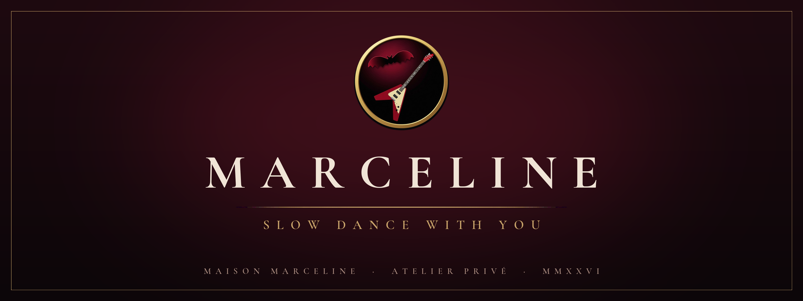
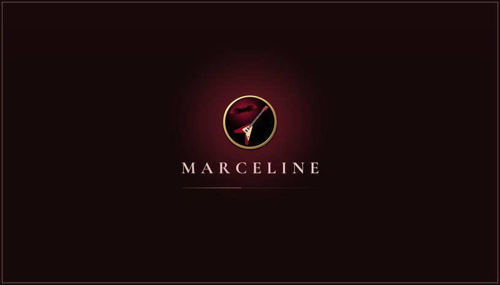
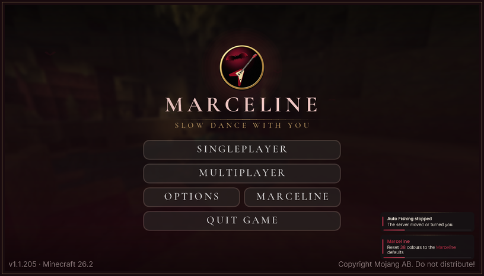
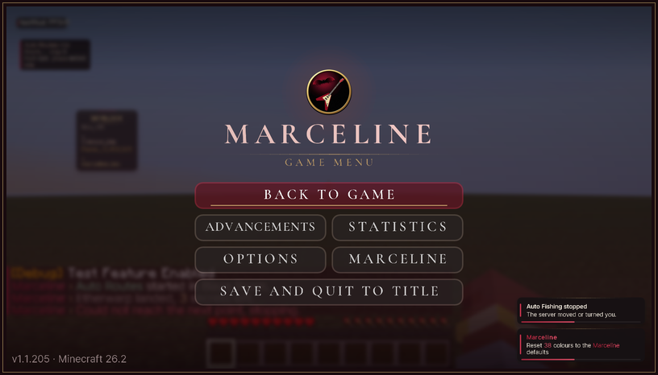
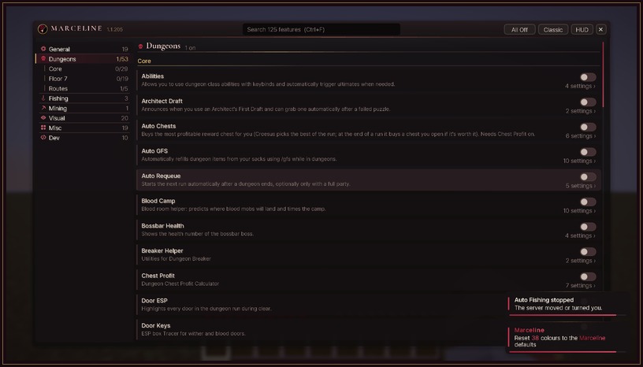

A PRIVATE COMPANION FOR HYPIXEL SKYBLOCK &nbsp;·&nbsp; FABRIC &nbsp;·&nbsp; MINECRAFT 26.2

 

<i>Made for one player. Never sold, never shared. 
Every detail drawn by hand, every movement given a human hand.</i>

 

THE LOADING SCREEN &nbsp;·&nbsp; THE TITLE &nbsp;·&nbsp; THE ESC MENU &nbsp;·&nbsp; THE SETTINGS — AS THEY APPEAR IN GAME

 

— ❦ —

<h3 align="center">THE COLLECTION</h3>

 

**N° 01 &nbsp;·&nbsp; FISHING** 
Water, lava and the hotspots between them.

It finds the edge, casts, reads the bite and reels in. It meets its own sea creatures with the Hyperion from a
safe angle, or with the weapon you choose. It sells what you list, rests when it should, and closes each session
with a written report. Short of mana or health, it waits. Felled, it returns to its place. Stalled, it notes why
and begins again.

**N° 02 &nbsp;·&nbsp; MINING** 
Mithril, Titanium, and the gemstones of your choosing.

It chooses each next block as a person would. In *Commissions*, it reads your tasks, travels a route you walked
once, mines what is asked, claims with the Royal Pigeon, and returns for more.

**N° 03 &nbsp;·&nbsp; DUNGEONS** 
From the first door to the Floor 7 relics.

The map, the puzzle solvers, the terminals, splits and chest profit; routes, with Secret Routes and the Assist
mods sewn into the lining.

**N° 04 &nbsp;·&nbsp; THE HAND** 
How every automatic movement is made.

A turn gathers speed, travels a gentle arc and settles, each axis at its own pace. Slips, pauses and reactions
are drawn from a single profile. When two features reach for the view at once, one broker decides. The arithmetic
is pure and tested to its distributions: a long tail, firm bounds, the same seed telling the same story.

**N° 05 &nbsp;·&nbsp; THE LOOK** 
Charcoal, wine and a thread of antique gold.

Titles in Cormorant Garamond, everything else in Pretendard. An original emblem: a red guitar and a bat, held
in a ring of gold. The colours carry from the first loading screen through the menus, the settings, the
notifications, the scoreboard, the chat and the tooltips, down to the buttons of the game itself.

 

— ❦ —

<h3 align="center">THE ESSENTIALS</h3>

| | |
|:--|:--|
| **To open** | `/mar`, or **MARCELINE** on the title screen and in the ESC menu |
| **To install** | The Marceline jar, with Fabric API and Fabric Language Kotlin. Assist Core and Assist Path come inside |
| **The journal** | One log per game, in `config/Marceline/journal/` and, as it is written, in `Downloads/Marceline/logs/` |
| **The settings** | `config/Marceline/` |

<h3 align="center">THE ARCHIVE</h3>

| | |
|:--|:--|
| [Features](docs/FEATURES.md) | every feature and what it does, generated from the code |
| [Roadmap](docs/ROADMAP.md) | what is done, what comes next |
| [Humanization](docs/HUMANIZATION.md) | how automatic input is shaped, with its numbers |
| [Fishing, compared](docs/FISHING-COMPARISON.md) | set beside other mods |
| [References](docs/REFERENCES.md) | sources |
| [House rules](AGENTS.md) | for working on the code |

<h3 align="center">THE ATELIER</h3>

Each push to <code>main</code> is built, tested and kept on the <code>ci-log</code> branch, 
with a release for every version. <code>[gametest]</code> runs the game itself; <code>[assist]</code> rebuilds the Assist mods.

<h3 align="center">WITH GRATITUDE</h3>

<b>NoammAddons</b> by Noamm, the ground this was built on (CC0 1.0) 
<b>Secret Routes</b> by yourboykyle (GPL-3.0) 
<b>Cormorant Garamond</b> and <b>Pretendard</b> (SIL Open Font License) 
Parts adapted from <b>Odin</b> and others, credited where they appear

Original work CC0 1.0 · Secret Routes GPL-3.0 · licence files in the repository

 

— ❦ —

MAISON MARCELINE &nbsp;·&nbsp; ATELIER PRIVÉ &nbsp;·&nbsp; MMXXVI

