# Riftwalk

A Hypixel SkyBlock toolkit for Fabric (Minecraft 26.2): fishing, dungeons and routes in one menu.
Private project, used on a private test server.

## What's in it

- **Fishing** — Auto Fishing with spot finding, travel, sea creature handling, selling and a session report.
  Every automatic input goes through `utils/Humanize.kt` (see `AGENTS.md`).
- **Dungeons** — dungeon helpers, Floor 7 tools and routes (Secret Routes built in).
- **Menus** — one settings window (`/rw`), a HUD editor, and Riftwalk's own title screen and ESC menu.
- **Logs** — one file per game run in `config/Riftwalk/journal/`, copyable to Downloads from the Auto Fishing settings.

## Install

1. Fabric Loader for 26.2, Fabric API and Fabric Language Kotlin.
2. Put `Riftwalk-<version>-26.2.jar` in `mods`.
3. In game: `/rw` opens the settings.

Builds come from CI on every push to `main` (the `ci-log` branch keeps the jar, the test results and screenshots).

## Built on

- **NoammAddons** by Noamm — the base this started from (CC0 1.0).
- **Secret Routes** by yourboykyle — included under GPL-3.0 (`LICENSE-SECRETROUTES.txt`).
- **Pretendard** font — SIL Open Font License (`LICENSE-PRETENDARD-OFL.txt`).
- Parts adapted from Odin (`LICENSE-ODIN.txt`) and others, credited in the files they came from.

Some features still use the NoammAddons data server (lowest BIN prices, puzzle data, player stats).
The WebSocket feature that talks to it is off by default.

## License

The original parts are CC0 1.0 (`LICENSE`). Secret Routes code is GPL-3.0, so a build that includes it
is shared under GPL-3.0 terms.
